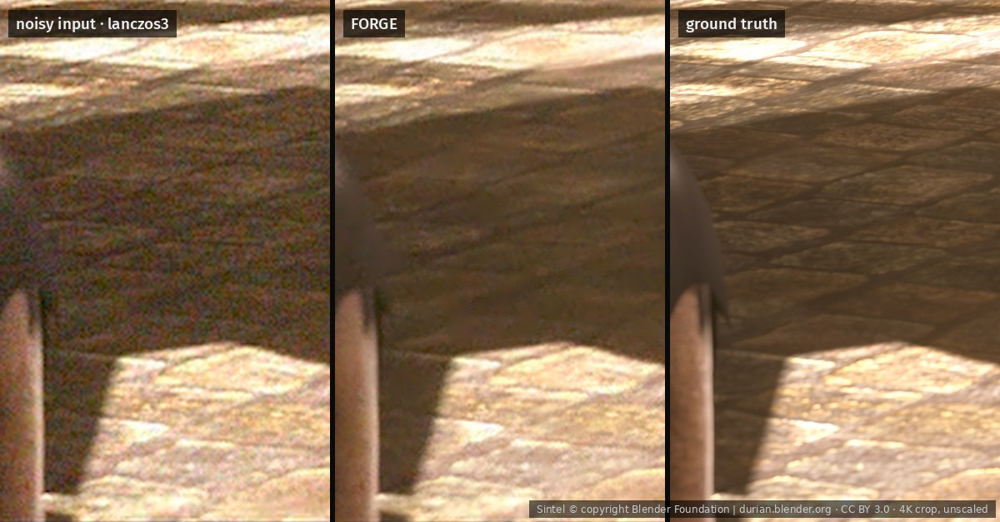
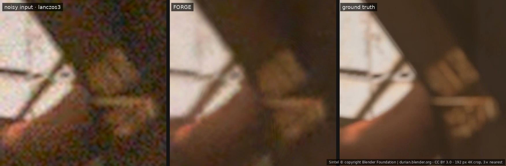

# FORGE protected-scene confirmation (2026-11-17)

**Disposition: SUPPORTED WITH QUALIFICATION.** The pre-recorded quality gate passes on scenes held out from tuning. The temporal-stability gate fails on noisy input. Real 4K60 playback has not been measured.

## Context

Since the 2026-09-16 status snapshot, implementation work has run in **ANVIL**, a private Linux/Vulkan video player. **FORGE** is the reconstruction stage built there:

- a lanczos3 base plus a small convolutional correction network (`output = lanczos3(LR) + delta(LR)`);
- an evidence-gated temporal path: noise-gated history fusion, noise-gated back-projection, and output-resolution accumulation that contributes only sub-pixel phases the current frame cannot see.

The ANVIL code is private. This record publishes the measurements and their limits, not the code. It is evidence for this repository's open questions; it does not declare New Forge's production architecture.

> **Update 2026-11-21: code published.** The FORGE code from ANVIL commit `41ba911` (GPU shaders, the host-side stage, the PyTorch replica, the weight constructor, and the default weights) and the gate scripts with their original outputs are now public under [`implementations/forge/`](../../implementations/forge/README.md). The rest of the ANVIL player stays private. The text of this record below is unchanged except for item 7 and the added "Supplementary scene" section.

## Evidence chain (per `evaluation/EVIDENCE_STANDARD.md`)

1. **Claim tested.** FORGE as built improves fidelity over lanczos3 alone on held-out scenes without regressing clean content. This is the F-QUALITY gate, recorded on 2026-11-07, before any tuning:
   - killed if the mean gain on CRF 23 + noisy cells is below **+0.05 dB**;
   - killed if clean cells regress by more than 0.05 dB;
   - "mic-drop" tier: at least **+0.3 dB** on CRF 23 + noisy with clean intact.
2. **Code identity.** ANVIL commits `8f3b6cf` (2026-11-16) and `41ba911` (2026-11-17). Default weights `merged-v2`, **hand-constructed by a script, not trained**. No AMD weights, shaders, or outputs were used as initialization, teacher, or data.
3. **Inputs and reference.**
   - Scenes: `sintel_rooftop`, `tos_daylight`, `tos_debris`; frames 72, 120, 168. These scenes are protected: not used in tuning.
   - 1280×720 input, 3840×2160 output (3×). Ground truth: the 2160p lossless master.
   - Arms: clean (CRF 10), CRF 23, and noisy twins.
4. **Controlled variable.** The FORGE stage versus lanczos3 alone on the same frames. Lanczos3 is also the output of the zero-initialized model, so it is the floor by construction.
5. **Baselines.** Lanczos3 alone; the spatial-only FORGE model; the 2026-11-15 player.
6. **Configuration.** Front end, temporal path, back-projection, and 4K accumulation all on; 19-frame warm-up. Measured on a replica of the player that is parity-checked against GPU captures (see item 10).
7. **Artifacts and logs.** Held in the private repository (`gate_confirm.json`, `spatial_protected.json`, per-scene logs). *Since 2026-11-21:* published unchanged in [`implementations/forge/gate/results-2026-11-17/`](../../implementations/forge/gate/results-2026-11-17/), with the scripts that wrote them in [`implementations/forge/gate/`](../../implementations/forge/gate/) and input checksums in `gate/INPUTS.sha256`.
8. **Quality metrics** (measured fact; dB over lanczos3, PSNR against ground truth):

   | Arm | Spatial model | 2026-11-15 player | **2026-11-17 player** |
   |---|---|---|---|
   | Clean | +0.053 | +0.054 | **+0.585** |
   | CRF 23, corpus clips | +0.033 | +0.034 | −0.030 |
   | CRF 23, aligned clips | +0.038 | +0.038 | **+0.414** |
   | Noisy | +1.507 | +4.096 | **+4.858** |

   - `tos_daylight` at CRF 27 (made from the master): +0.182.
   - The gate passes on either CRF 23 clip set. The mic-drop tier is met only with the aligned clips.
9. **Temporal metric** (measured fact; M2 edge flicker on frame pairs N/N+1):
   - below lanczos3 on clean, both CRF 23 sets, and CRF 27: **pass**;
   - above lanczos3 on the noisy twins (0.0792 vs 0.0643): **fail**. Every FORGE version fails here, including the spatial model, so the failure predates the temporal work.
10. **Competing explanations.**
    - **Ruler defect (measured fact).** The corpus CRF 23 clips sit 1.3–1.7 px vertically off the ground-truth master. They were cut from the released film, not the master. That penalizes any output that moves toward the truth. Clips re-cut from the master align within 0.03 px. Which ruler the gate uses going forward is an **unresolved** decision.
    - **Noisy-arm gain is largely denoising (engineering inference).** On noise, the 720p history is used on 98–99.5% of pixels. On clean and compressed content it is mostly rejected (2–22% of pixels, low weight), while the 4K history is kept on 89–98% of pixels. The noisy numbers therefore should not be read as recovered detail.
    - **Replica versus GPU (measured fact).** GPU/replica parity passes on clean cells (max 2 codes, mean 0.0145) and fails on the noisy cell (max 6 codes). The noisy-arm figures carry that gap.
11. **Excluded or invalid evidence.**
    - The shifted corpus CRF 23 ruler is retained and flagged, not deleted.
    - Negative result retained: an earlier fine-tune of AMD's FSR 4 network for compressed video was **killed** by its own pre-recorded gate (−0.005 dB against a required +0.05 dB). FORGE replaced it.
12. **Disposition.** SUPPORTED WITH QUALIFICATION.

## Performance (reported separately from quality)

- 1280×720 → 3840×2160, whole FORGE stage, GPU timestamps; AMD RX 7900 GRE, RADV (Mesa).
- All on: **9.77 ms median** (p90 9.84 ms). Accumulation off: 6.57 ms.
- Measured at the GPU's mid-clock state, the state headless test playback holds it in.
- Limit: ≤ 10 ms for the whole stage. This was amended on 2026-11-15, before these measurements, from an arbitrary 5 ms. The governing criterion is 4K playback at 60 fps (frame time under 16.6 ms).
- Real-playback frame-to-frame time at 4K60 has **not** been measured.

## Independent re-run (2026-11-19)

**Measured fact.** The same replica and default weights were re-run from a separate script on the same protected cells: 9 clean, 9 aligned-CRF 23, and 6 noisy frames. The re-run used the CPU, because a ROCm 10.1 update made host-to-GPU copies crash intermittently.

Whole-frame means over lanczos3 match the table above exactly: **+0.585 dB** (clean), **+0.414 dB** (aligned CRF 23), **+4.858 dB** (noisy).

**Tile-level ranking** (96×96 tiles at 4K, mean squared error against ground truth):

- **Largest gain on clean or compressed input:** +1.70 dB in one tile (`sintel_rooftop` f120, clean).
- **Largest gain on a lit, textured noisy tile:** stone texture buried in noise is recovered, close to ground truth.

  
- **Worst tile: −5.75 dB** (`sintel_rooftop` f168 noisy, frame edge).

  

**Observation, not root-caused.** In the worst tile, FORGE places a moving object where it was earlier rather than where it is now. This looks like stale temporal history (ghosting). A fainter dark smear is visible beside the post in the gain figure as well.

**Hypothesis.** History fusion on noisy input (used on 98–99.5% of pixels, see item 10) is not rejecting regions with motion or disocclusion. This should be tested against the noisy-arm F-TEMPORAL failure.

## Supplementary scene: Sintel cave (added 2026-11-21)

**Measured fact.** The same protocol was run on `sintel_cave`, frames 72/120/168. The outputs were in the private repository and are published with the code (`cave_confirm.json`, `sintel_cave_crf23a.json`).

**Not held out.** `sintel_cave` is part of the temporal tuning set (`tools/forge_tdev.py`), so these numbers are not evidence of generalization. They are recorded so the published outputs are not selectively reported.

| Arm | dB over lanczos3 | M2 flicker, FORGE vs lanczos3 |
|---|---|---|
| Clean (CRF 10) | +0.450 | 0.0699 vs 0.0707 (pass) |
| CRF 23, corpus clips (shifted ruler) | +0.029 | 0.0709 vs 0.0716 (pass) |
| CRF 23, aligned clips | +0.239 | 0.0712 vs 0.0720 (pass) |
| CRF 27 | +0.150 | 0.0708 vs 0.0718 (pass) |
| Noisy | +5.988 | 0.0677 vs 0.0542 (**fail**) |

The pattern matches the protected scenes: the shifted CRF 23 clips understate the gain, and flicker fails on noisy input.

## What this record does not establish

- New Forge's production architecture. No decision record has been written for FORGE.
- How much of the gain is recovered information versus inference. No reprojection residuals or frequency analysis are reported here.
- Generalization beyond three protected scenes and nine frames.

## Credits

Test scenes are from the Blender Foundation's open movies, used under CC BY 3.0:

- *Sintel* © copyright Blender Foundation | durian.blender.org
- *Tears of Steel* © copyright Blender Foundation | mango.blender.org
